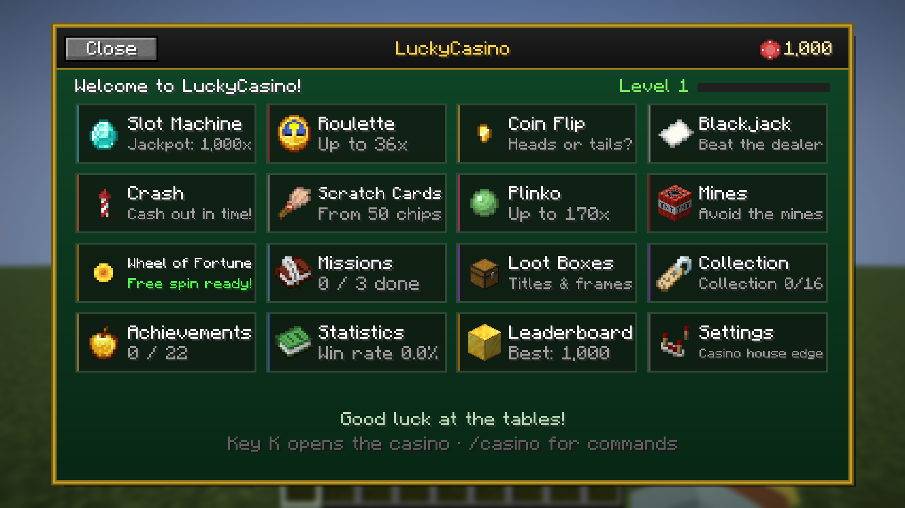
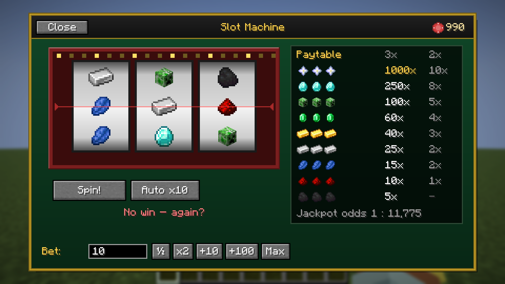
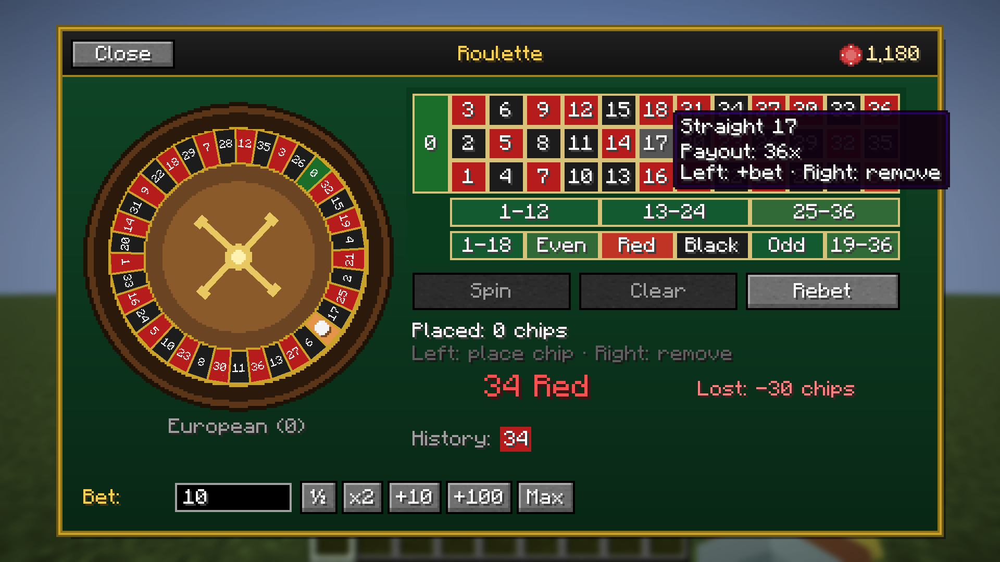
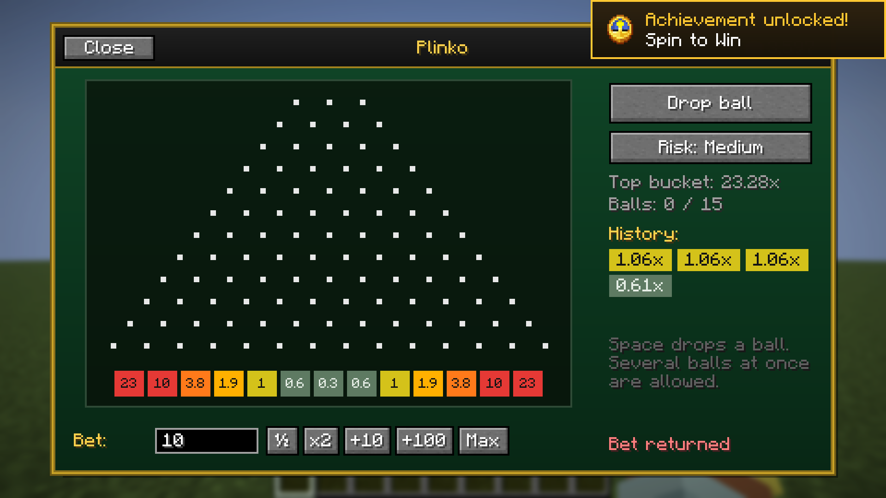
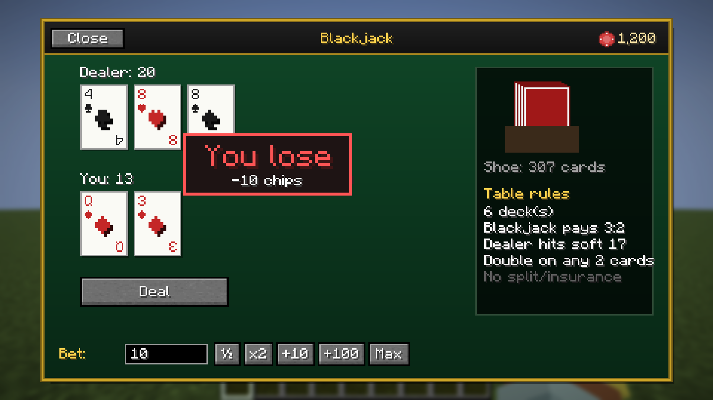
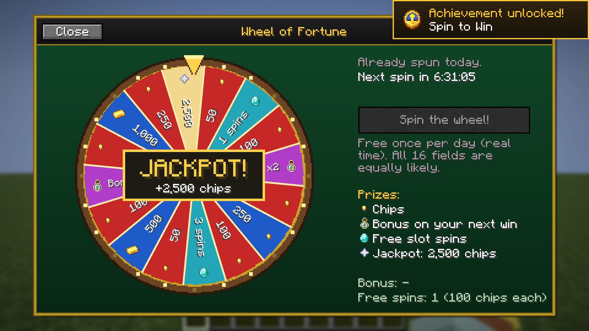
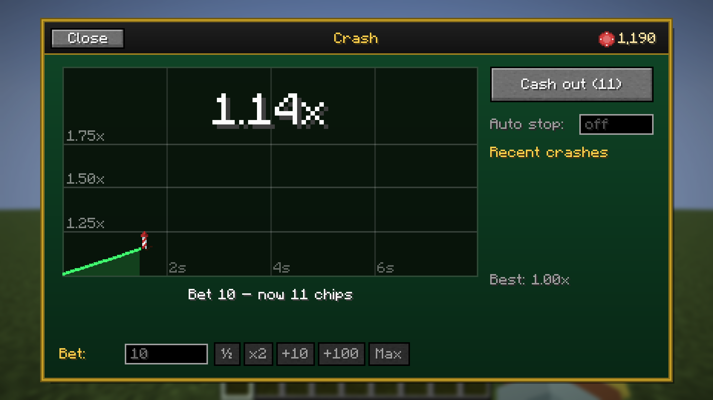
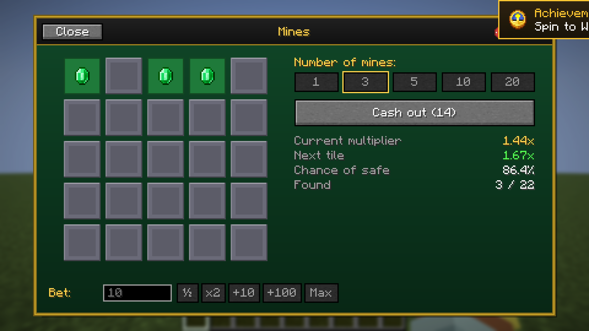

<p align="center">
  
</p>

# LuckyCasino

    

**Minecraft 1.21.11 · Fabric · Java 21 · nur Client** · von **redstone_nugget**

Ein komplettes Casino direkt in Minecraft, gespielt wird mit virtuellen Chips: Slot-Maschine, Roulette,
Münzwurf, Blackjack, Crash, Rubbellose, Plinko und Minenfeld, dazu ein tägliches Glücksrad, Lootboxen,
Missionen, Erfolge und Statistiken. Die Mod läuft komplett auf deinem Rechner, braucht nichts auf dem Server
und funktioniert deshalb auch auf fremden Servern.

<p align="center">
  
  
</p>
<p align="center">
  
  
</p>

> **English:** A complete casino inside Minecraft, played with virtual chips: slot machine, roulette, coin flip,
> blackjack, crash, scratch cards, Plinko and Mines, plus a daily wheel of fortune, loot boxes, missions,
> achievements and statistics. Client-side only, no server mod needed. German and English included.

> **Nur Spielgeld.** Chips sind rein virtuell und lokal gespeichert. Es gibt keine echten Items,
> keine Server-Währung, nichts zu kaufen und keinen Netzwerkzugriff.

## Download

[**Modrinth**](https://modrinth.com/mod/luckycasino) oder [**GitHub Releases**](https://github.com/RedstoneNugget/LuckyCasino/releases).

## Installation

1. [Fabric Loader](https://fabricmc.net/use/) (≥ 0.19) für Minecraft 1.21.11 installieren.
2. [Fabric API](https://modrinth.com/mod/fabric-api) in den `mods`-Ordner legen.
3. `luckycasino-2.0.0.jar` in den `mods`-Ordner legen.
4. Optional: [Mod Menu](https://modrinth.com/mod/modmenu), dann sind die Einstellungen auch über die Mod-Liste erreichbar.

## Bedienung

| Eingabe | Funktion |
|---|---|
| **K** | Casino öffnen (unter *Optionen → Steuerung* änderbar) |
| **Leertaste** | Hauptaktion im Spiel: Drehen, Werfen, Austeilen, Cash out … |
| `/casino open` | Casino öffnen |
| `/casino balance` | Guthaben anzeigen |
| `/casino reset` | Spielstand zurücksetzen |

## Spiele

| Spiel | Kurz erklärt |
|---|---|
| **Slot-Maschine** | 3 Walzen, Jackpot 1000×, Auto-Spin |
| **Roulette** | Europäischer Kessel, alle üblichen Wetten, bis 36× |
| **Münzwurf** | Kopf oder Zahl, mit „Doppelt oder nichts“ |
| **Blackjack** | 6 Decks, Blackjack zahlt 3:2, Dealer zieht bei Soft 17 |
| **Crash** | Der Multiplikator steigt, rechtzeitig auszahlen, optional automatisch |
| **Rubbellose** | Mit der Maus freirubbeln |
| **Plinko** | 3 Risikostufen, mehrere Kugeln gleichzeitig |
| **Minenfeld** | 5×5 Felder, 1–20 Minen, jederzeit auszahlen |

<p align="center">
  
  
</p>
<p align="center">
  
  
</p>

## Extras

- Tägliches **Glücksrad** (einmal pro Tag, alle 16 Felder gleich wahrscheinlich)
- **Lootboxen** mit Titeln und Rahmenfarben für deine Sammlung
- **Tagesmissionen** und **Casino-Level** mit XP
- **Erfolge** mit Einblendungen, **Statistik** mit Guthaben-Diagramm, lokale **Bestenliste**
- Verschiebbare Guthaben-Anzeige im Spiel
- **Notkredit** bei 0 Chips (alle 10 Minuten)
- Einstellbare **Pausen-Erinnerung**

## Glücksfaktor

In den Einstellungen wählbar: *Fair*, *Casino-Hausvorteil* oder *Hardcore*. Alle Gewinnchancen stehen
dokumentiert in [`Odds.java`](src/main/java/de/luckycasino/core/Odds.java) und werden von Unit-Tests nachgerechnet.

## Speicherung

`config/luckycasino.json` enthält Guthaben, Statistiken und Einstellungen. Eine beschädigte Datei wird als
`.corrupt-…` gesichert, danach wird die letzte Sicherung (`.bak`) oder ein neuer Spielstand geladen.

## Entwicklung

Benötigt JDK 21.

```
gradlew build              → build/libs/luckycasino-2.0.0.jar (inkl. Unit-Tests)
gradlew runClient          → Spiel mit Mod starten
gradlew runClientGameTest  → automatischer In-Game-Test mit Screenshots
python tools/gen_lang.py   → Sprachdateien (de_de/en_us) neu erzeugen
```

Eine neue Version erscheint automatisch, sobald ein Tag wie `v2.0.1` hochgeladen wird: GitHub baut die Mod,
erstellt ein Release und lädt die `.jar` auf Modrinth hoch (Text aus `.github/release-notes.md`).

## Lizenz

[MIT](LICENSE) © 2026 redstone_nugget
